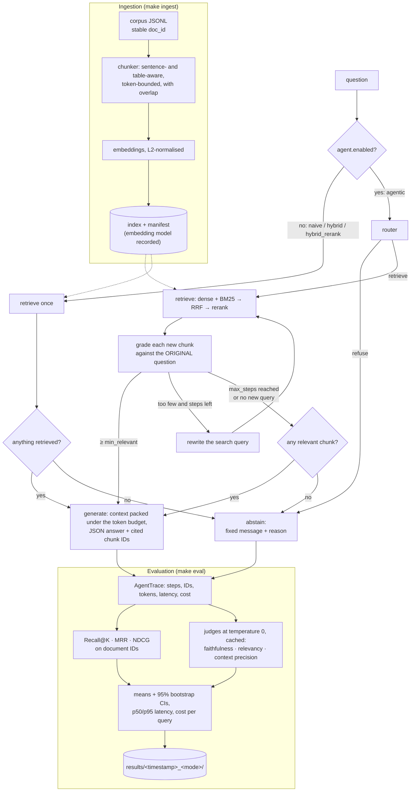

# Agentic RAG with an Evaluation Harness

A retrieval-augmented QA pipeline with hybrid search, cross-encoder reranking and a
**bounded corrective agent loop** (route → retrieve → grade → rewrite → generate or
abstain), plus an evaluation harness that measures it: deterministic retrieval metrics
on document IDs, structured LLM-as-a-judge metrics, latency and cost, saved per run so
that configurations can be compared.

> [!IMPORTANT]
> **No benchmark results yet.** The previous version of this README reported RAGAS
> scores (+22% faithfulness, +37% context precision), injection-resistance rates and
> latency/cost figures that were never measured: the files in `results/` were generated
> by `random.uniform` in `scripts/mock_data.py`. [`docs/AUDIT.md`](docs/AUDIT.md) documents
> that and every bug found in the old code. This version produces real numbers when run
> with an API key; the table below stays empty until that has been done.

## How it works



**Design choices**

- **One chunk ID everywhere.** `chunk_id = "<doc_id>::<position>"` is produced by the
  chunker and used by the dense index, BM25, RRF, citations and metrics. In the old
  code dense and BM25 hits had different IDs, so "hybrid" search never fused anything.
- **Exact cosine search on normalised vectors**, with the embedding model recorded in the
  index manifest; querying with a different model raises `IndexMismatchError` instead of
  returning silently wrong neighbours. Exact search keeps every vector in memory, which is
  comfortable for tens of thousands of chunks; beyond that, put FAISS or a vector database
  behind `Retriever`.
- **BM25 with Lucene's IDF** (always positive) and punctuation-free tokens, fused with the
  dense ranking by Reciprocal Rank Fusion, which needs ranks only, not comparable scores.
- **A bounded loop in plain Python.** `for` over `agent.max_steps`; rewrites change only the
  search query, never the question that is graded and answered. Every LLM failure has a
  recorded fallback (router → retrieve, grader → not relevant, rewriter → stop, generator →
  abstain), and an empty or irrelevant retrieval abstains instead of answering from memory.
- **Budgets in tokens.** Retrieved text is packed under `budgets.max_context_tokens`, and the
  whole prompt, including the JSON-schema instruction, is checked against
  `budgets.max_prompt_tokens` before the call.
- **Structured, cached, deterministic LLM calls.** Every call (router, grader, rewriter,
  generator, judges) runs at temperature 0, returns JSON validated by a Pydantic schema
  with one repair retry, goes through an SQLite cache keyed by (provider, model, prompt
  hash), retries rate limits and 5xx with exponential backoff, and records tokens, cost
  and latency.
- **Ablations change one stage at a time.** All modes share one index; `naive` → `hybrid`
  adds BM25 + RRF, `hybrid_rerank` adds the reranker, `agentic` adds the loop.

## Setup

```bash
python -m venv .venv && source .venv/bin/activate
```

```bash
make install-dev
```

```bash
cp .env.example .env
```

Put your key in `.env` (`OPENAI_API_KEY=...`). Keys are read only from the environment;
`config.yaml` names the variable (`llm.api_key_env`) and never holds a key. For the
cross-encoder reranker also run `pip install "sentence-transformers>=3.0"`.

**Gemini or another OpenAI-compatible API** needs no code change, only configuration.
Add your Gemini models to `pricing:` in `config.yaml` to get costs. The defaults are
OpenAI's, and Gemini's model names change, so check the current ones; untested here.

```bash
make eval ARGS="--set llm.api_key_env=GEMINI_API_KEY --set llm.base_url=https://generativelanguage.googleapis.com/v1beta/openai/ --set models.generator=gemini-2.5-flash --set models.agent=gemini-2.5-flash --set models.judge=gemini-2.5-pro --set models.embedding=gemini-embedding-001 --set llm.seed=null"
```

## Smoke test without an API key

`make smoke` runs ingestion, the `naive` and `agentic` evaluations and the comparison with
the **offline provider**: hashed bag-of-words embeddings, a lexical reranker and
word-overlap heuristics in place of every LLM call. It checks that the plumbing works end
to end, in a few seconds. Its scores say nothing about model quality.

```bash
make smoke
```

## Ingest, evaluate, compare

```bash
make ingest
```

```bash
make eval MODE=naive
```

```bash
make eval MODE=agentic
```

```bash
make compare
```

`make compare` compares the latest `naive` run (A) with the latest `agentic` run (B);
pass `A=results/<run> B=results/<run>` for any other pair. Run all four modes with
`make eval-all`. Any config key can be overridden, either through `ARGS` or directly:

```bash
python -m src.run_eval --mode agentic --top_k 5 --max_steps 3 --set retrieval.rrf_k=30 --limit 20
```

**The 30-question RAGBench set.** `make ragbench` builds a pooled corpus and an
evaluation set from the RAGBench samples in `data/ragbench_samples/` (finance, biomedical
and legal). Each question's gold documents are the documents RAGBench paired with it, and
its reference answer is RAGBench's LLM-generated `response`, marked as such.

```bash
make ragbench
```

```bash
make ingest ARGS="--corpus data/ragbench_corpus.jsonl --index-dir .cache/ragbench-index"
```

```bash
make eval-all ARGS="--dataset data/ragbench_eval.jsonl --set ingestion.index_dir=.cache/ragbench-index"
```

### What a run saves

Each run writes `results/<UTC timestamp>_<mode>[_<name>]/`:

| File | Contents |
|---|---|
| `config.resolved.yaml` | the exact configuration after presets and overrides |
| `report.json` | metrics with 95% bootstrap CIs and `n`, p50/p95 latency per stage, cost, git commit, dataset and index fingerprints |
| `traces.jsonl` | per question: retrieved chunk IDs, every agent step, queries tried, the answer and citations, judge rationales, tokens, latency |
| `worst_cases.jsonl`, `worst_cases.md` | the lowest-scoring questions with full traces, for error analysis |
| `run.log` | the run's log as JSON lines |

## Benchmark

| Configuration | Recall@5 | MRR | Faithfulness | Answer relevancy | Context precision | Abstention accuracy | p50 latency | Cost / query |
|---|---|---|---|---|---|---|---|---|
| Dense RAG (`naive`) | — | — | — | — | — | — | — | — |
| Hybrid BM25 + dense (`hybrid`) | — | — | — | — | — | — | — | — |
| Hybrid + rerank (`hybrid_rerank`) | — | — | — | — | — | — | — | — |
| Agentic RAG (`agentic`) | — | — | — | — | — | — | — | — |

*Not measured yet: this environment has no API key.* To fill the table, run `make
eval-all` on the 30-question set, then take the numbers from each run's `report.json` or
from `python -m src.compare_runs <A> <B> --markdown`. Report each mean with its 95% CI
and `n`: with 30 questions, differences smaller than the CIs are noise.

## Evaluation methodology

- **Retrieval metrics** compare the document IDs of the context the generator saw (in
  order, duplicates removed) with `gold_doc_ids`: Recall@K, MRR and binary NDCG@K, for
  answerable questions with gold IDs.
- **Judges** use `models.judge`, which should differ from the generator to limit
  self-preference bias; `config.yaml` warns when they are the same. Each judge writes its
  reasoning before the verdict:
  - *faithfulness*: the answer is split into atomic claims, each marked supported or not;
    the score is supported / total.
  - *answer relevancy*: a 1–5 rubric mapped to 0–1.
  - *context precision*: each chunk is judged on its own, so the order of the other chunks
    cannot sway the verdict; the score is the average precision of the useful chunks.

  All judges are pointwise, so the position bias of pairwise A/B judging does not arise.
- **Abstention is scored explicitly.** For an unanswerable question, abstaining is correct
  (`abstention_accuracy`). For an answerable one, abstaining scores 0 relevancy. An
  abstention has no claims to check, so faithfulness is `None` rather than a free 1.0.
- **Failures are counted, never invented.** A judge that returns unusable output gives
  `None` with the error stored, and the report counts queries with errors (`n_errors`).
- **Uncertainty.** Every metric reports its `n` and a 95% percentile-bootstrap interval.

## Tests and CI

`make test` runs 107 tests in about two seconds with **no API key and no network**:
LLM calls go to a scripted fake or to the offline backend, and the OpenAI SDK itself is
exercised through `httpx.MockTransport`.

| File | Covers |
|---|---|
| `tests/test_agent_loops.py` | multi-step retrieval and synthesis; stopping at exactly `max_steps`; malformed JSON (repaired or falling back); empty retrieval; router refusal; retries; token budgets; concurrent queries not sharing state |
| `tests/test_retrieval_metrics.py` | Recall@K, MRR, NDCG and RRF against hand-computed values, with empty lists, duplicate IDs and K beyond the list; BM25 tokenisation and IDF; filters; index/model mismatch |
| `tests/test_evaluator.py` | judges with valid, malformed, refused and out-of-range replies; abstention edge cases; aggregates finite and within [0, 1] |
| `tests/test_ingestion.py` | token limits, preserved overlap, sentence and table boundaries, deterministic IDs, manifest |
| `tests/test_llm.py` | temperature 0, cache hits and provider namespacing, retry policy, costs, the OpenAI request format via mocked HTTP |
| `tests/test_cli.py` | ingest → eval → compare end to end, cached re-runs, CLI overrides and error exits |

```bash
make test
```

```bash
make lint
```

GitHub Actions runs ruff (lint and format) and the tests on Python 3.10 with dependency
ranges and on Python 3.13 with the pinned `requirements.txt`, followed by `make smoke`.

## Project structure

```
├── config.yaml             # every tunable, plus the ablation presets under `modes`
├── src/
│   ├── schemas.py          # Pydantic contracts shared by all modules (and the config schema)
│   ├── utils.py            # config + CLI overrides, logging, token counting, SQLite cache, provenance
│   ├── llm.py              # async OpenAI-compatible and offline clients: JSON outputs, retries, cost
│   ├── ingestion.py        # chunking and index build (python -m src.ingestion)
│   ├── retriever.py        # cosine index, BM25, RRF, reranking, filters
│   ├── agent.py            # router, grader, rewriter, bounded loop, budgeted generation
│   ├── evaluator.py        # retrieval metrics, judges, aggregation
│   ├── run_eval.py         # benchmark CLI (python -m src.run_eval)
│   └── compare_runs.py     # run comparison (python -m src.compare_runs)
├── data/
│   ├── sample_corpus.jsonl # 79 RAGBench finance + biomedical documents
│   ├── sample_eval.jsonl   # 5 questions, human-written references, 1 unanswerable
│   └── ragbench_samples/   # raw RAGBench samples (source for make ragbench)
├── scripts/prepare_ragbench.py
├── tests/                  # offline test suite
└── docs/AUDIT.md           # audit of the previous version
```

## Limitations

- Nothing here has been run against a real model API, because this environment had no
  key. The OpenAI request and response handling is tested through the real SDK with mocked
  HTTP; the Gemini settings above are untested.
- The cross-encoder reranker path is not exercised in CI, because it needs a model
  download.
- The sample set has 5 questions and the RAGBench set 30: enough to compare
  configurations roughly, not to rank them precisely. RAGBench gold documents are the
  documents paired with each question, so a few are off-topic; its reference answers are
  LLM output.
- Exact search loads all embeddings into memory.

## Changes from the previous version

The mock-data scripts, the generated `results/`, and the committed Chroma databases were
removed. So were the Streamlit app, the notebook and the adversarial suite: they were
built on the old modules and displayed the generated numbers, and the adversarial runner
could not fail (a pipeline that crashes on every input scored 90%). Prompt-injection
hygiene is kept in the generation prompt: documents are delimited and treated as data,
and closing tags inside them are escaped.

## Data

`data/` contains samples of [RAGBench](https://huggingface.co/datasets/rungalileo/ragbench)
(FinQA, PubMedQA and CUAD subsets); see the dataset card for its licence.
